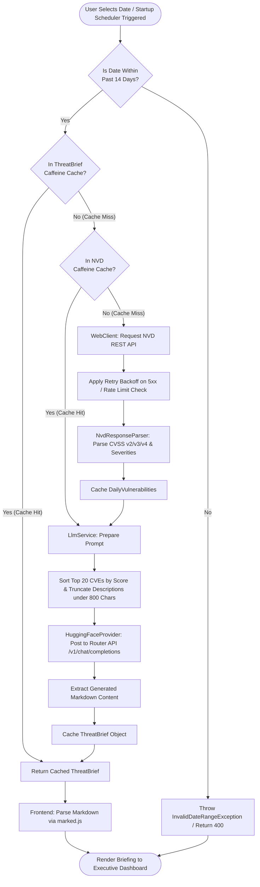
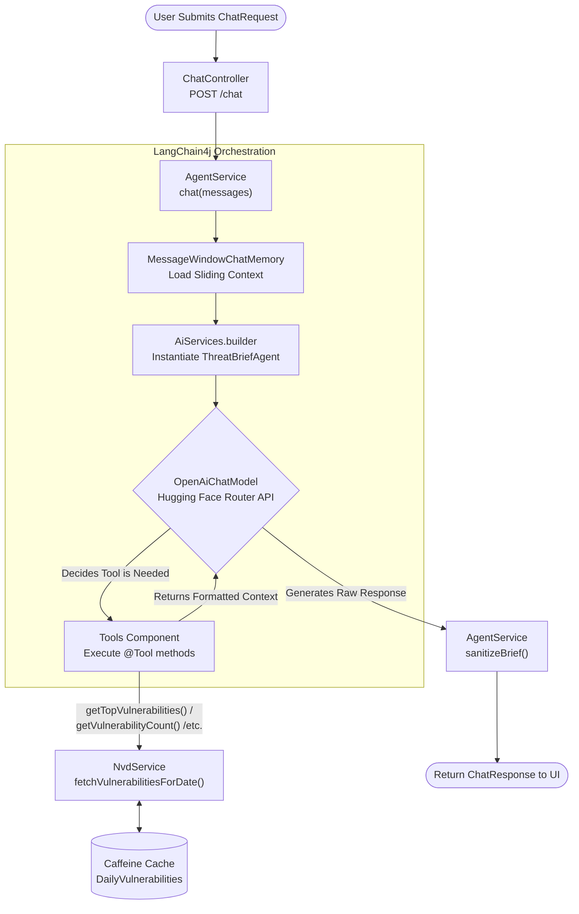

# 🛡️ ThreatBrief — AI-Automated Security Intelligence Aggregator

**ThreatBrief** is a reactive full-stack security platform that aggregates daily vulnerability feeds from the **National Vulnerability Database (NVD)**, processes and ranks CVE risks, and leverages **Large Language Models (Hugging Face / LangChain4j)** to generate executive threat intelligence briefings and interactive SecOps chat assistance.

🌐 **Live Demo:** [https://threatbrief.co.za](https://threatbrief.co.za)

---

## 📐 Architecture & Data Flow

---

## 💡 Engineering & Architectural Highlights

### Reactive I/O & API Resilience
Integrating with external APIs like the National Vulnerability Database (NVD) and Hugging Face introduced network latency and strict rate limits as primary system bottlenecks. To ensure the application remains responsive under heavy load, the backend is built on Spring WebFlux for non-blocking I/O. Outbound `WebClient` requests to NVD v2.0 utilize custom Netty address resolvers and expanded 16 MB codec buffers. The service incorporates resilience patterns via Reactor Retry, executing exponential backoff retries (3 attempts, max 2-second delay) on transient 5xx server errors while mapping 4xx and rate-limit responses to domain-specific exceptions.

### Two-Tier Caching & Rolling Pre-Generation
To deliver sub-second response times without exceeding LLM context windows or upstream API quotas, ThreatBrief uses a two-tier Caffeine caching strategy for raw `DailyVulnerabilities` and synthesized `ThreatBrief` objects. A background scheduler (`ThreatBriefScheduler`) triggers automatic pre-generation on application startup and at hourly intervals across a strict 14-day rolling UTC window. Pre-generation processes requests sequentially with a 6-second delay between dates using reactive `Flux` streams to prevent rate-limiting. Before passing data to the LLM, the data pipeline sorts vulnerabilities by CVSS score, limits the payload to the top 20 items, and truncates descriptions to 800 characters.

### Interactive SecOps Agent & LangChain4j Tools

Beyond static briefings, ThreatBrief provides an interactive conversational assistant via the `/chat` endpoint using **LangChain4j**. The `AgentService` orchestrates conversational context using a sliding `MessageWindowChatMemory` capped at 10 messages and connects to an OpenAI-compatible Hugging Face endpoint via `OpenAiChatModel`. The agent is armed with Spring-managed `@Tool` methods (`getVulnerabilityCount`, `getTopVulnerabilities`, `getRecentDates`) that query `NvdService` on demand. Output sanitization automatically strips raw `<think>` scratchpad tags from the model response before rendering.

### Resource-Conscious Cloud Runtime
Deploying on a memory-constrained AWS EC2 instance required explicit resource safeguards. The build pipeline uses multi-stage Docker builds paired with JVM heap boundaries (`-Xmx512m`) and host-level swap allocation to eliminate out-of-memory crashes during compilation. In production, the application runs inside a lightweight Temurin Alpine JRE container as a restricted non-root user (`threatuser`), isolated behind an Nginx reverse proxy handling SSL termination and port forwarding.

### Automated CI/CD & Cloud Deployment
Deployments are fully automated using a GitHub Actions pipeline triggered on pushes to `main`. The workflow compiles the application, runs unit tests, and builds a multi-stage Docker image published to GitHub Container Registry (GHCR). It then opens a secure SSH session to the AWS EC2 host to pull the new image, gracefully swap the running container, and prune obsolete layers—ensuring reliable, zero-touch deployments without manual server intervention.

---

## 🛠️ Tech Stack

- **Backend & AI:** Java 25, Spring Boot 4.1.1 (WebFlux), LangChain4j, Netty, Caffeine Cache, Jackson JSR-310
- **Frontend:** Vanilla JS (Async/Await), HTML5, CSS3 (Dark Theme), Marked.js
- **Testing:** JUnit 5, Reactor Test, MockWebServer
- **DevOps & Cloud:** GitHub Actions, GHCR, Docker (Multi-stage), Nginx (Certbot SSL), AWS EC2 (Ubuntu)